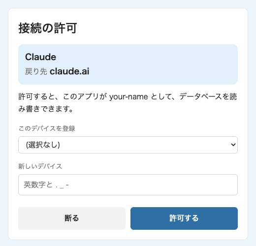

# 導入方法

## 前提条件

| 項目 | 条件 |
|---|---|
| OS | Windows・macOS・Linux |
| Node.js | 22.13 以上 |
| AI エージェント | Claude Code(v2.1.310 以上)、Codex(v0.164 以上)。どちらか一方でも、両方でも使えます |

## インストール

```bash
npm install -g warifuri
```

<details>
<summary>Windows の PowerShell で動かないとき</summary>

「このシステムではスクリプトの実行が無効になっています」と表示された場合は、`warifuri` の代わりに `warifuri.cmd` と入力してください。

</details>

<details>
<summary>macOS・Linux で動かないとき</summary>

`npm install -g` で「EACCES」と表示された場合は、`sudo` を付けずに、nvm などで自分のユーザーに Node.js をインストールし直してください。

「command not found: warifuri」と表示された場合は、`npm prefix -g` で表示されるフォルダの `bin` を PATH に追加してください。

</details>

## セットアップ

| 使い方 | 内容 | 参照箇所 |
|---|---|---|
| 1台で使う | 自分の PC だけで使う | 下の 1〜3 |
| ホストする | VM や常に起動している PC にサーバーを置き、ほかの PC からも使う | 下の 1・2 と[ホストする場合](#ホストする場合) |
| クライアントとして使う | ホストされたサーバーに、別の PC から接続する | [クライアントとして使う場合](#クライアントとして使う場合) |

### 1. データフォルダの作成

```bash
warifuri init
```

`~/.warifuri/`(Windows では `%USERPROFILE%\.warifuri`)に、設定ファイル `warifuri.env` のひな形などを作ります。すでにあるファイルは書き換えません。

### 2. サーバーの起動

```bash
warifuri serve
```

`warifuri: serving http://127.0.0.1:8787/mcp` と表示されれば起動しています。データベース(`~/.warifuri/ledger.sqlite`)は最初の起動で作られ、この PC の中(`127.0.0.1`)からの接続だけを受け付けます。

<details>
<summary>「GitHub login off」について</summary>

GitHub ログインを設定していないため、シークレットだけで接続するという意味です。1台で使う場合は、このままで問題ありません。ほかの PC から使う場合は、[ホストする場合](#ホストする場合)を見てください。

</details>

<details>
<summary>ポートを変更する(8787 番以外を使う)</summary>

8787 番をほかのアプリが使っている場合は、`warifuri.env` に `WARIFURI_PORT=8788` のように書きます。`serve` と `connect` の両方がこの値を読みます。`connect` を実行したあとで変えた場合は、`warifuri.env` の `WARIFURI_SERVER_URL` の行を削除してから、`connect` をもう一度実行してください。

</details>

### 3. Claude Code と Codex への接続

サーバーを一度起動したら、別のターミナルで次を実行します。

```bash
warifuri connect
```

<details>
<summary>connect の詳細</summary>

- この PC 用のシークレット(`wf_` で始まる文字列)を発行し、ユーザーだけが読めるファイル `~/.warifuri/device.key` に保存します。デバイス名は PC のホスト名で、`--device <名前>` で変更できます。
- `claude` と `codex` に、MCP サーバーを `warifuri` という名前で登録します。
- タスク確認を、Claude Code の `~/.claude/settings.json` と Codex の `~/.codex/hooks.json` に追加します。
- 秘書のスキルをコピーします。

書き換える設定ファイルは、先に `<ファイル>.bak-warifuri-<日時>` としてバックアップします。何度実行しても同じ結果になります。

| オプション | 内容 |
|---|---|
| `--dry-run` | 何をするかだけ表示する |
| `--harness claude`・`--harness codex` | 片方だけに接続する |
| `--no-hook` | タスク確認を設定しない |
| `--no-skills` | 秘書のスキルをコピーしない |
| `--force` | スキルを新しい版に入れ替える |

</details>

> 🟧 **Claude Code**
>
> 起動後、`/mcp`(またはターミナルの `claude mcp list`)で `warifuri` が `Connected` になっていれば、そのまま使えます。

> ⬛ **Codex**
>
> `connect` が作ったシークレットのファイル(`~/.warifuri/device.key`)の中身を、環境変数 `WARIFURI_DEVICE_KEY` に設定してから `codex` を起動します。起動したら、Codex の中で `/hooks` を開き、タスク確認を一度信頼してください。
>
> macOS・Linux の場合:
>
> ```bash
> export WARIFURI_DEVICE_KEY="$(cat ~/.warifuri/device.key)"
> ```
>
> Windows(PowerShell)の場合:
>
> ```powershell
> $env:WARIFURI_DEVICE_KEY = (Get-Content "$env:USERPROFILE\.warifuri\device.key" -Raw).Trim()
> ```
>
> <details>
> <summary>毎回設定しないで済ませる(Windows)</summary>
>
> ```powershell
> [Environment]::SetEnvironmentVariable('WARIFURI_DEVICE_KEY', (Get-Content "$env:USERPROFILE\.warifuri\device.key" -Raw).Trim(), 'User')
> ```
>
> </details>
>
> 接続できたかは、Codex に「warifuri の board を見せて」と頼んで確かめられます。

### ホストする場合

GitHub ログインを用いることで、VM や常に起動している PC に置いたサーバーに、ほかの PC や Claude の Web・アプリから接続できます。

<details>
<summary>手順(公開 URL を https://warifuri.example.com にする例)</summary>

1. 上の 1・2 のとおり、サーバーの PC で `warifuri init` と `warifuri serve` を実行します。
2. サーバーの前に HTTPS を置き、外から接続できる URL(公開 URL)を用意します。たとえば、同じ PC で Caddy を使う場合は、次の設定で HTTPS の証明書も自動で用意されます。

   ```
   warifuri.example.com {
     reverse_proxy 127.0.0.1:8787
   }
   ```

   HTTPS を置く PC がサーバーの PC と別の場合は、`warifuri.env` の `WARIFURI_HOST` も変更します。
3. GitHub の Settings → Developer settings → OAuth Apps で、次のように OAuth App を作ります。

   | 項目 | 例 |
   |---|---|
   | Application name | `warifuri` |
   | Homepage URL | `https://warifuri.example.com` |
   | Authorization callback URL | `https://warifuri.example.com/oauth/github/callback` |

4. データフォルダの2つのファイルに次を書き、`warifuri serve` を再起動します。

   `warifuri.env`:

   ```
   WARIFURI_PUBLIC_URL=https://warifuri.example.com
   WARIFURI_GITHUB_USER=<GitHub のユーザー名>
   WARIFURI_GITHUB_CLIENT_ID=<OAuth App の Client ID>
   ```

   `secrets.env`:

   ```
   WARIFURI_GITHUB_CLIENT_SECRET=<OAuth App の Client Secret>
   ```

</details>

起動時に「GitHub login off」が表示されなければ、GitHub ログインが使えます。足りない項目は `warifuri config` で確認できます。

### クライアントとして使う場合

ホストされたサーバーに、別の PC から接続します。この PC にも warifuri をインストールしてから、次を実行します。

```bash
warifuri connect --url https://<サーバー> --device <デバイス名>
```

最初に使うときにブラウザが開くので、GitHub でログインし、この PC のデバイス名を選びます。

<details>
<summary>接続の許可の画面</summary>

GitHub でログインすると、次の画面が開きます。



- 上の枠:接続しようとしているアプリの名前と戻り先です。名前はアプリが自分で名乗るものなので、戻り先(`claude.ai` など)が合っているかで確かめてください。
- このデバイスを登録:同じ PC のほかのエージェントですでに名前を付けている場合は、ここから選びます。
- 新しいデバイス:初めて接続する PC の場合は、名前を英数字と `.` `_` `-` で入力します。
- 「許可する」を押すと、エージェントからデータベースを読み書きできるようになります。

</details>

タスク確認を使うには、この PC のシークレットも必要です。サーバーの PC で次を実行し、表示されたシークレットを、この PC の `~/.warifuri/device.key` に1行で書きます。

```bash
warifuri key add <デバイス名>
```

## 秘書

秘書は、タスク管理と予定調整を定期実行する AI エージェントです。既定ではオフです。何をするかは[使い方](usage.md#3-秘書)にあります。

サーバーの PC で Claude Code にログインしてから、次を実行し、`warifuri serve` を再起動します。

```bash
warifuri secretary enable
```

止める場合は `warifuri secretary disable` を実行し、`warifuri serve` を再起動します。時刻は[設定](configuration.md)で変更できます。

<details>
<summary>秘書が使えるもの</summary>

秘書が使えるのは warifuri のツールだけで、claude.ai のコネクタ(メールやカレンダー)は既定では使えません。カレンダーを使わせる方法は[連携の例](integrations.md#秘書にカレンダーを使わせる)にあります。

</details>

## 設定

設定は、データフォルダの `warifuri.env` に `名前=値` の形で書きます。秘密の値は `secrets.env` に分けます。項目の一覧は[設定](configuration.md)に、設定の例は [examples/](../examples/README.md) にあります。今の値は `warifuri config` で確認できます。

<details>
<summary>文字コードの注意(Windows)</summary>

`warifuri.env` は UTF-8 で保存してください。Windows PowerShell 5.1 の `>>` で行を書き足すと、その部分だけ UTF-16 になり、読めなくなります。

</details>

## 更新・バックアップ・アンインストール

### 更新

サーバーを停止してから、次を実行します。

```bash
npm install -g warifuri@latest
```

```bash
warifuri connect --force
```

### バックアップ

データベースを日付つきのファイルにバックアップします。サーバーの起動中でも実行でき、新しいものから7つ(`--keep` で変更可)を残します。

```bash
warifuri backup --dir <バックアップ先のフォルダ>
```

### アンインストール

<details>
<summary>手順</summary>

1. サーバーを停止します。
2. Claude Code の `~/.claude/settings.json` と Codex の `~/.codex/hooks.json` の `hooks` の `PreToolUse` から、`warifuri hook gate`(Windows では `warifuri.cmd hook gate`)を呼ぶ項目を削除します。ほかのフックは残してください。
3. スキルのフォルダ `~/.claude/skills/warifuri-secretary/` と `~/.codex/skills/warifuri-secretary/` を削除します。
4. MCP サーバーの登録を削除します。

   ```bash
   claude mcp remove --scope user warifuri
   ```

   ```bash
   codex mcp remove warifuri
   ```

5. 環境変数 `WARIFURI_DEVICE_KEY` を設定していた場合は、削除します。
6. パッケージをアンインストールします。

   ```bash
   npm uninstall -g warifuri
   ```

7. 不要になった場合は、データフォルダ `~/.warifuri/` を削除します。データベース・設定・シークレットが入っています。

</details>
